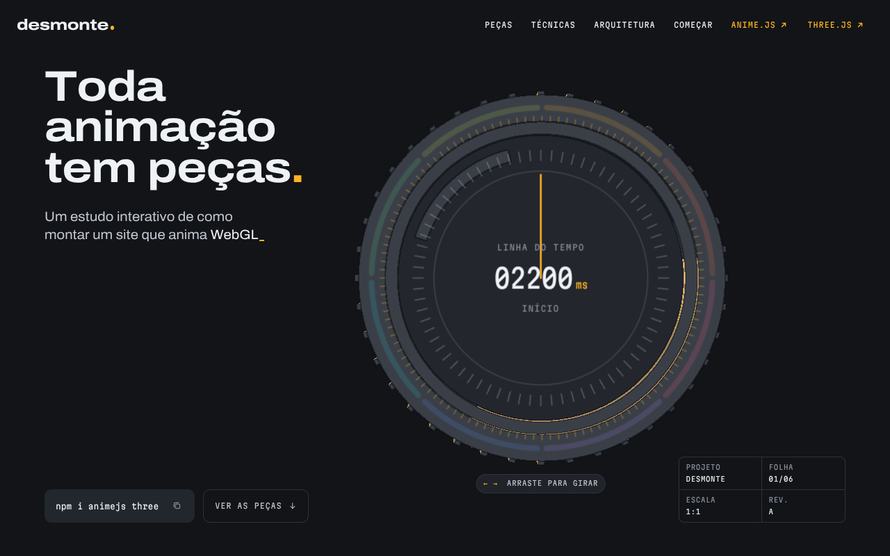
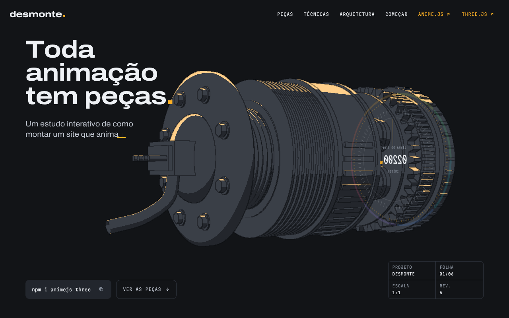
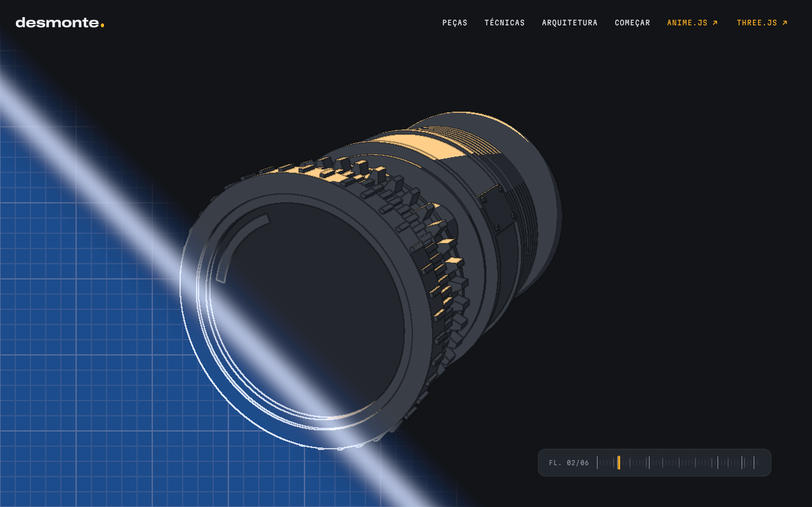
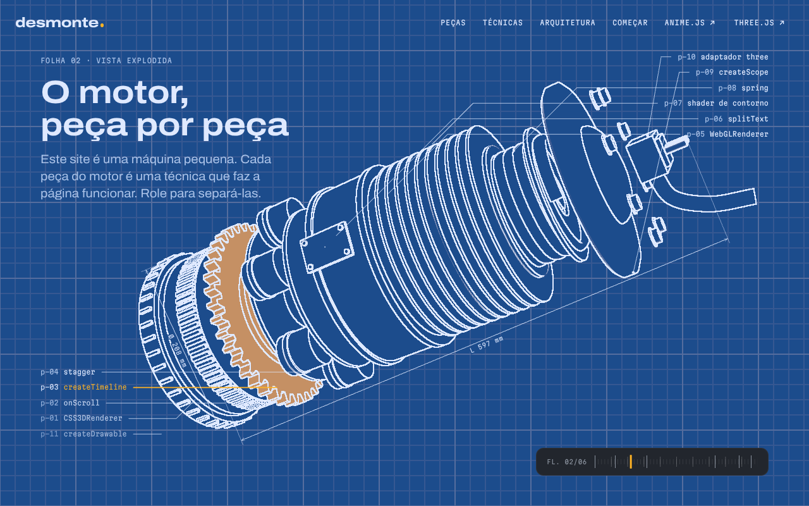
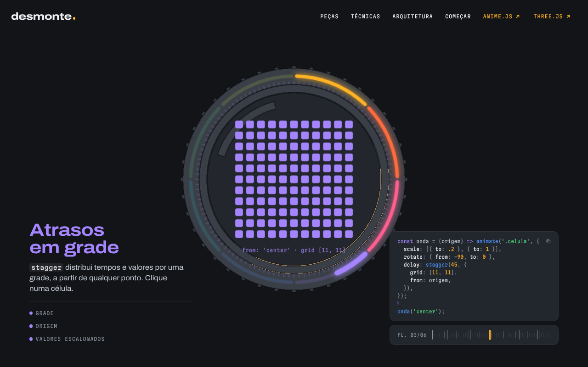
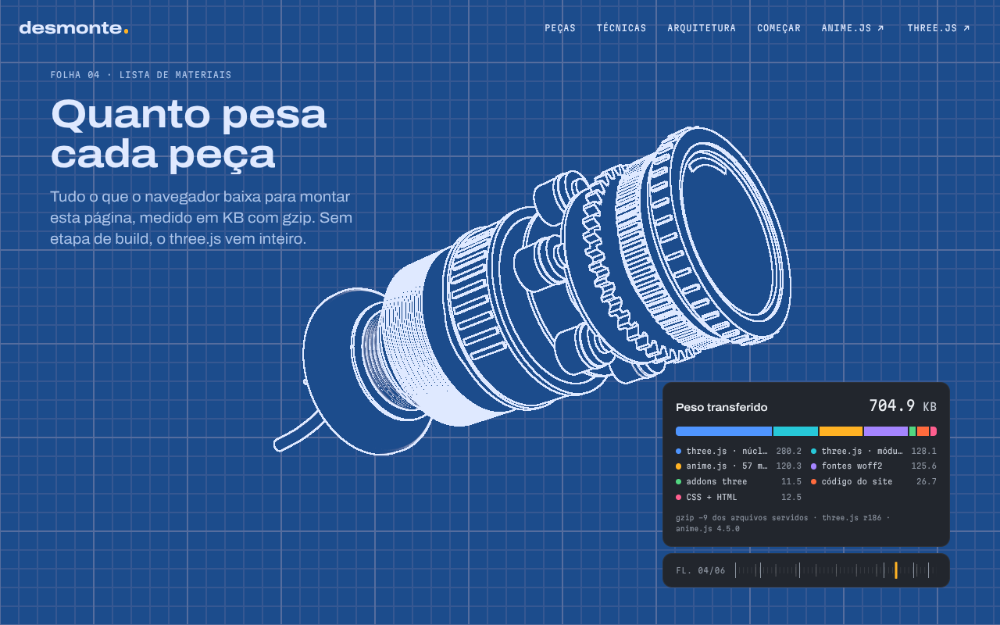
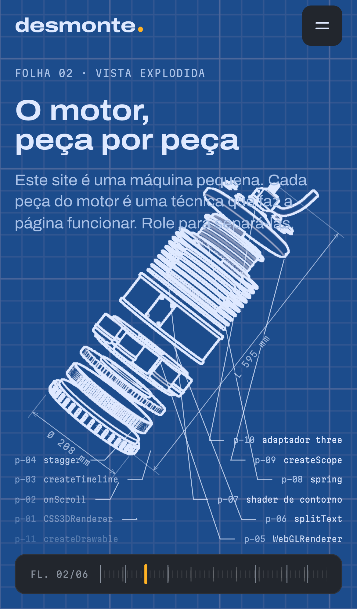

# Desmonte

**Prova de conceito: como se constrói um site animado no estilo do [animejs.com](https://animejs.com), peça por peça.**

Um motor 3D gerado em código fica fixo atrás da página. O scroll dirige uma única timeline que gira o motor, explode as peças, troca o tema para uma "planta azul" de desenho técnico e liga demonstrações em DOM real coladas na tela do motor. Tudo com [three.js](https://threejs.org) e [anime.js 4.5](https://animejs.com), sem etapa de build.



> Projeto de estudo independente, feito a partir da engenharia reversa da página inicial do animejs.com. Não é afiliado ao projeto anime.js. Nenhum modelo, texto, imagem ou fonte do site original foi reutilizado: a geometria, a marca, as demos e os textos são próprios.

---

## Sumário

- [O que esta prova de conceito demonstra](#o-que-esta-prova-de-conceito-demonstra)
- [Capturas](#capturas)
- [Como rodar](#como-rodar)
- [Como funciona](#como-funciona)
  - [1. Camadas da página](#1-camadas-da-página)
  - [2. Scroll vira tempo: a timeline mestra](#2-scroll-vira-tempo-a-timeline-mestra)
  - [3. O visual de desenho técnico (shader)](#3-o-visual-de-desenho-técnico-shader)
  - [4. DOM dentro do 3D](#4-dom-dentro-do-3d)
  - [5. Interação sem conflito](#5-interação-sem-conflito)
  - [6. Texto e interface](#6-texto-e-interface)
- [Estrutura do código](#estrutura-do-código)
- [Como adaptar](#como-adaptar)
- [Peso e desempenho](#peso-e-desempenho)
- [Limitações](#limitações)
- [Créditos e licença](#créditos-e-licença)

---

## O que esta prova de conceito demonstra

| Técnica | Onde aparece |
|---|---|
| **Timeline mestra dirigida pelo scroll** (`createTimeline` + `onScroll` + objeto proxy) | O site inteiro: cada capítulo é um trecho de uma única timeline |
| **Adaptador three.js do anime.js** | Animar `x`, `rotateY`, `scale` de objetos 3D e uniforms de shader direto com `animate()` |
| **Pós-processamento de contorno** (detecção de bordas de Roberts) | O visual de "desenho técnico" e a troca para a planta azul |
| **Transição em varredura no shader** | A planta azul entra na diagonal com uma linha de luz e grade de prancheta |
| **`CSS3DRenderer`** | As demos são HTML/SVG reais coladas na tela do motor |
| **Vista explodida com rótulos e cotas projetados do 3D** | Linhas de chamada e medidas em mm calculadas ao vivo |
| **`createDraggable` + `spring()`** | Arrastar para girar o motor; a régua de progresso; a demo de mola |
| **`createAnimatable`** | Paralaxe do mouse, luz seguindo o cursor, letras reagindo à proximidade |
| **`splitText` e `scrambleText`** | Títulos que se montam, rótulos embaralhados, número da folha |
| **Fonte variável animada** (`fontStretch`, `fontWeight`) | Título que "se estica" na entrada |
| **`createScope` com media queries** | Enquadramentos diferentes para celular e desktop |
| **8 demos interativas** | `animate`, `composition: 'blend'`, `onScroll`, `stagger` em grade, ferramentas SVG, `createDraggable`, timeline como sequenciador, `createScope` |

---

## Capturas

| | |
|---|---|
|  **Arrastar para girar:** a mola traz o motor de volta. |  **Varredura:** a planta azul entra na diagonal. |
|  **Vista explodida:** passar o mouse num rótulo acende a peça. |  **Técnicas:** demo, HUD ao vivo e código ao lado. |
|  **Arquitetura:** o peso real de tudo que a página baixa. |  **Celular:** rótulos e enquadramentos próprios. |

---

## Como rodar

Não há dependências para instalar. Basta servir a pasta com qualquer servidor HTTP (módulos ES não carregam por `file://`):

```bash
git clone https://github.com/matheushodecker/desmonte.git
cd desmonte
npx serve .
```

ou, sem Node:

```bash
python3 -m http.server 8080
```

Abra o endereço que aparecer e role a página. Experimente:

- passar o mouse sobre o título e mexer o mouse sobre o motor;
- arrastar o motor para os lados, no início;
- passar o mouse e clicar nos rótulos da vista explodida;
- clicar nas células da demo de *stagger* e arrastar a peça da demo de mola;
- arrastar o cursor âmbar da régua no canto inferior direito.

three.js 0.186.1 e anime.js 4.5.0 vêm do jsDelivr pelo *import map* do `index.html`; as fontes (Archivo e Martian Mono) vêm do Google Fonts. É preciso estar on-line.

**Dicas de depuração**

- `?nosmooth` no fim da URL desliga a suavização do scroll.
- No console: `__desmonte.master.currentTime`, `__desmonte.master.labels`, `__desmonte.proxy.time`.
- Com "reduzir movimento" ligado no sistema, a abertura e as animações em loop são puladas.

**Publicar no GitHub Pages:** em *Settings → Pages*, escolha *Deploy from a branch*, branch `main`, pasta `/ (root)`. O site fica em `https://<usuario>.github.io/desmonte/`.

---

## Como funciona

### 1. Camadas da página

```
┌─────────────────────────────────────────────┐
│ header                                      │  z 6
│ régua de progresso + cartões de código      │  z 5
│ <main>: capítulos, textos e espaçadores     │  z 2   (pointer-events só no que é visível)
│ CSS3DRenderer: a tela do motor (DOM em 3D)  │  z 1
│ #engine: canvas WebGL, position: fixed      │  z 0
└─────────────────────────────────────────────┘
```

Cada capítulo é uma `<section data-chapter data-label="PECAS">` com espaçadores de `100lvh`. Os espaçadores só existem para dar altura de rolagem; os textos de alguns capítulos ficam `position: fixed` e aparecem quando o capítulo está ativo.

### 2. Scroll vira tempo: a timeline mestra

É o truque central (o mesmo do site original). A animação inteira é **uma** timeline escrita em milissegundos, com um *label* por capítulo:

```js
const master = createTimeline({ autoplay: false })
  .label('PECAS', 3200)
  .add(rig.turnRig, { rotateY: -90, duration: 900 }, 'PECAS')       // o motor vira de lado
  .add(rig.groups, { z: (g) => g.userData.baseZ * 1.55 }, 'PECAS+=350') // e explode
  .label('PECAS_END', 6200);
```

Uma segunda timeline, ligada ao scroll da página inteira, anima um objeto proxy de `LABEL` até `LABEL_END`, com duração igual à **altura do capítulo em pixels**. A cada atualização, a mestra salta para o tempo do proxy:

```js
const proxy = { time: 0 };
const scroller = createTimeline({
  autoplay: onScroll({ target: document.body, enter: 'max', leave: 'min', sync: 0.9 }),
  onUpdate: () => master.seek(proxy.time),
});
chapters.forEach((chapter) => {
  const label = chapter.dataset.label;
  scroller.add(proxy, {
    time: [master.labels[label], master.labels[label + '_END']],
    duration: chapter.offsetHeight,
  }, chapter.offsetTop);
});
```

Resultado: a animação é pensada em tempo, o layout em altura. Para alongar um capítulo, basta mais um espaçador; nenhuma animação muda. A abertura usa a mesma timeline, tocada por tempo no carregamento.

As 8 técnicas têm uma timeline própria, ligada só ao trecho delas com `onScroll(...).link(tl)`: o arco do anel da tela é desenhado conforme você rola, e a demo ativa é decidida a partir do tempo dessa timeline.

### 3. O visual de desenho técnico (shader)

O motor é renderizado em duas passadas (`js/toon.js`):

1. Cada peça é desenhada com um material que não produz a cor final: o RGB é uma **cor de identificação** da peça misturada com a normal da superfície, e o alfa é a **luz quantizada** (sombra, meio-tom, brilho).
2. Um quad de tela cheia detecta bordas nessa imagem (operador de Roberts: 4 amostras na diagonal) e pinta com duas paletas ao mesmo tempo, a escura e a planta azul. Um único uniform, `printMix`, move uma frente de varredura diagonal entre elas, com uma linha de luz na frente e a grade de prancheta no fundo.

Com o adaptador three do anime.js, trocar de tema é animar um número:

```js
import 'animejs/adapters/three';
master.add(outlineMaterial, { printMix: [0, 1], duration: 450 }, 'PECAS+=30');
```

### 4. DOM dentro do 3D

A tela circular do motor é um `<div>` de 400 × 400 px transformado pelo `CSS3DRenderer`, que usa a mesma câmera do WebGL. As demos são HTML e SVG animados pelo anime.js, e um HUD embaixo mostra valores ao vivo (`x`, `progress`, `velocity`).

A demo de arraste é a exceção: fica numa camada plana alinhada à tela por projeção, porque o `Draggable` não considera a `perspective` que o `CSS3DRenderer` usa.

### 5. Interação sem conflito

O motor recebe movimento de quatro fontes. Para que uma não apague a outra, cada uma tem um nível próprio na hierarquia:

```
stageRig  -> enquadramento         (timeline mestra)
mouseRig  -> paralaxe              (createAnimatable)
spinRig   -> arrastar para girar   (createDraggable + spring)
tiltRig   -> inclinação            (timeline mestra)
turnRig   -> orientação            (timeline mestra)
device    -> as peças
```

A engrenagem e o anel serrilhado giram sozinhos e aceleram com a velocidade do scroll; a direção da luz segue o mouse.

### 6. Texto e interface

- Títulos quebrados com `splitText`; palavras sobem de dentro de uma máscara (`wrap: 'clip'`).
- `scrambleText` nos rótulos, sobretítulos, número da folha e dica da régua.
- Fonte variável: as letras do título entram estreitas e se esticam; depois engordam perto do cursor.
- Régua de progresso com cursor arrastável, cursor-fantasma e nome do capítulo.
- Carregador que conta os arquivos baixados com `PerformanceObserver`, antes mesmo dos módulos rodarem.
- Se o CDN falhar, a página volta a um layout estático e legível em 8 s.

O passo a passo completo da engenharia reversa do site original, com trechos do código decifrado e todas as armadilhas encontradas, está em **[GUIA.md](GUIA.md)**.

---

## Estrutura do código

```
index.html          capítulos, textos, cartões de código, import map, carregador
css/style.css       tokens de cor e tipo, camadas, layout responsivo
js/main.js          timeline mestra, scroll → tempo, técnicas, escopo responsivo, laço de desenho
js/stage.js         renderer WebGL + CSS3DRenderer
js/toon.js          material de identificação + passada de contorno, varredura e grade
js/device.js        o motor gerado em código, hierarquia de rigs e âncoras
js/screen.js        a tela do motor (DOM em 3D), HUD e camada plana alinhada
js/demos.js         as 8 demonstrações
js/callouts.js      rótulos, linhas de chamada e cotas da vista explodida
js/interaction.js   paralaxe, luz, arrastar para girar, velocidade do scroll, destaque de peças
js/hero.js          entrada do título e palavra que troca
js/reveals.js       capítulos que se montam, créditos em 3D, marca gigante do rodapé
js/chrome.js        menu, âncoras, cópia, cartões de código, régua de progresso
js/highlight.js     realce de sintaxe dos cartões
js/chart.js         gráfico de peso
tools/medir.mjs     mede o peso real (gzip) de cada parte
docs/               capturas usadas neste README
GUIA.md             engenharia reversa do animejs.com
```

---

## Como adaptar

**Novo capítulo**

1. Crie a seção com `data-chapter`, `data-label="NOVO"` e espaçadores.
2. Em `buildMaster()` (`js/main.js`), entre os labels vizinhos:
   ```js
   .label('NOVO', 9000)
   .add(rig.turnRig, { rotateY: 45, duration: 600 }, 'NOVO')
   .label('NOVO_END', 10000)
   ```
3. O scroller encontra o capítulo sozinho pelo `data-label`.

**Nova demo**

Escreva uma função em `js/demos.js` que receba o elemento raiz e devolva `{ enter, leave, hud }` (e `syncable`, se o progresso deve seguir o scroll). Registre em `BUILDERS` e crie o `<article class="feature" data-feature="...">` e o `<pre class="code-card" data-card="...">` correspondentes.

**Cores e tipografia**

Os tokens ficam no topo de `css/style.css` (`--graphite`, `--amber`, `--print`, `--c0`…`--c7`). As cores do 3D ficam em `DARK` e nos uniforms de `js/toon.js`.

---

## Peso e desempenho

Medido com `node tools/medir.mjs` (gzip -9):

| Parte | KB |
|---|---|
| three.js (núcleo + módulo) | 408 |
| anime.js (57 módulos ESM) | 120 |
| Fontes woff2 | 126 |
| Addons three (CSS3DRenderer, BufferGeometryUtils) | 12 |
| Código do site | 38 |
| CSS + HTML | 14 |

Sem build, o navegador baixa o three.js inteiro. Com esbuild ou Vite, o *tree-shaking* corta o three.js para o que é usado (o chunk equivalente do site original tem 133 KB com gzip):

```bash
npm i three animejs
npx esbuild js/main.js --bundle --format=esm --minify --splitting --outdir=dist
```

O pós-processamento roda por pixel; a densidade é limitada a 2× e reduzida em telas muito grandes.

---

## Limitações

Esta é uma **prova de conceito**, não um produto:

- Depende de CDN (jsDelivr e Google Fonts); não funciona off-line.
- Sem build, carrega mais código que o necessário (ver acima).
- Precisa de WebGL para o motor; sem ele, a tela em DOM e as demos continuam, sem o 3D.
- Testado em Chromium (desktop e emulação de celular). Safari e Firefox não foram testados a fundo.
- O conteúdo da tela 3D é decorativo para leitores de tela; os textos e links ficam no HTML normal.

---

## Créditos e licença

- [three.js](https://github.com/mrdoob/three.js) e [anime.js](https://github.com/juliangarnier/anime), licença MIT.
- [Archivo](https://fonts.google.com/specimen/Archivo) e [Martian Mono](https://fonts.google.com/specimen/Martian+Mono), licença SIL OFL.
- Inspirado na engenharia da página inicial do [animejs.com](https://animejs.com), de Julian Garnier. Projeto independente, sem afiliação.

O código deste repositório está sob a [licença MIT](LICENSE).
